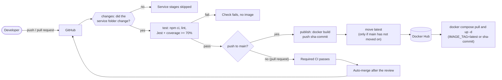

# Pipeline

CI/CD is one reusable workflow, `.github/workflows/_service-ci.yml`, called by one thin, path-filtered
workflow per service (for example `.github/workflows/auth-service.yml`). `_service-ci.yml` is owned by the PM
only (see `.github/CODEOWNERS`).

## Stages

1. **changes** – `dorny/paths-filter` checks whether `<service>/**` or the workflow files changed. If not,
   the service stages are skipped.
2. **test** (every pull request and push) – Node 20, `npm ci`, `npm run lint` (ESLint), `npm test`
   (Jest with coverage). The Jest config sets the 70% line-coverage threshold, so a miss fails the stage.
3. **publish** (push to `main` only, after `test`) – build the Docker image from `<service>/Dockerfile` and
   push it to Docker Hub as `<DOCKERHUB_USERNAME>/<service>:sha-<commit>`. Then move `latest` to that same
   image, but only if `main` has not moved on in the meantime. Concurrent runs for one service queue up
   instead of overwriting each other.
4. **Required CI (`<service>`)** – the one check branch protection requires. It passes when `changes` passed and,
   if the service changed, `test` passed. On pushes to `main`, `publish` must also pass; on pull requests and
   pushes to `develop`, `publish` is skipped, so a green pull request check does not mean an image was
   published. It is the check name the repo requires.

Auto-merge (`.github/workflows/auto-merge.yml`) turns on GitHub auto-merge for non-draft pull requests. It
approves nothing and does not bypass branch protection.

## Integration and E2E

`e2e.yml` runs after a successful service workflow on `main` (or on manual dispatch). It pulls the four
service images tagged `latest`, starts the compose stack, and runs E2E-01 (Playwright) through the gateway.
The workflow uploads the Playwright report on every run and tears down the stack even when a test fails. The
service workflows still publish `sha-<commit>` and `latest` after their unit gates; E2E is the verification
step for the published `latest` images and does not promote images or run IT-01..03.

## Who owns what

| Part | Owner |
|---|---|
| `_service-ci.yml`, `auth-service.yml`, compose files, nginx, frontend, docs, CODEOWNERS | @Pinont (PM) |
| `restaurant-service/` and `restaurant-service.yml` | @Hydra07188 |
| `review-service/` and `review-service.yml` | @flogame55 |
| `favorite-service/`, `e2e/`, `favorite-service.yml`, `e2e.yml` | @phoo3011 |

## Add a new service workflow

1. Copy `docs/templates/service-workflow.yml` to `.github/workflows/<service>.yml` and replace `SERVICE` with
   the service folder (for example `restaurant-service`). Keep the job named `Required CI (<service>)`.
2. Copy `docs/templates/Dockerfile` to `<service>/Dockerfile` and set the port: auth 3001, restaurant 3002,
   review 3003, favorite 3004. Add a `.dockerignore`. The template is for plain JavaScript services. For a
   TypeScript service (`review-service`, `favorite-service`) use `review-service/Dockerfile` as the
   reference instead: it builds with `npm run build` in a first stage, installs only production dependencies
   in the final stage and starts `dist/src/server.js`, not `src/server.js`.
3. In the service's `package.json`, define a `lint` script (ESLint) and a `test` script that runs Jest with
   `--coverage` and a 70% `coverageThreshold`.
4. Add the workflow file to `.github/CODEOWNERS` under its owner.
5. In GitHub branch protection for `main`, require the check `Required CI (<service>)`.
6. Make sure the repository secrets `DOCKERHUB_USERNAME` and `DOCKERHUB_TOKEN` exist (they are inherited).
7. Check the service has a compose entry and a gateway route: the service name in `docker-compose.yml` must
   match the upstream name in `nginx/nginx.conf`.
8. Open a pull request. After the merge to `main`, the image appears on Docker Hub as `sha-<commit>` and
   `latest`.
